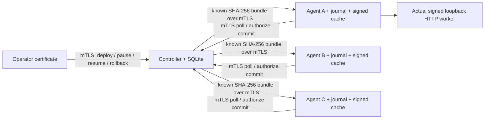
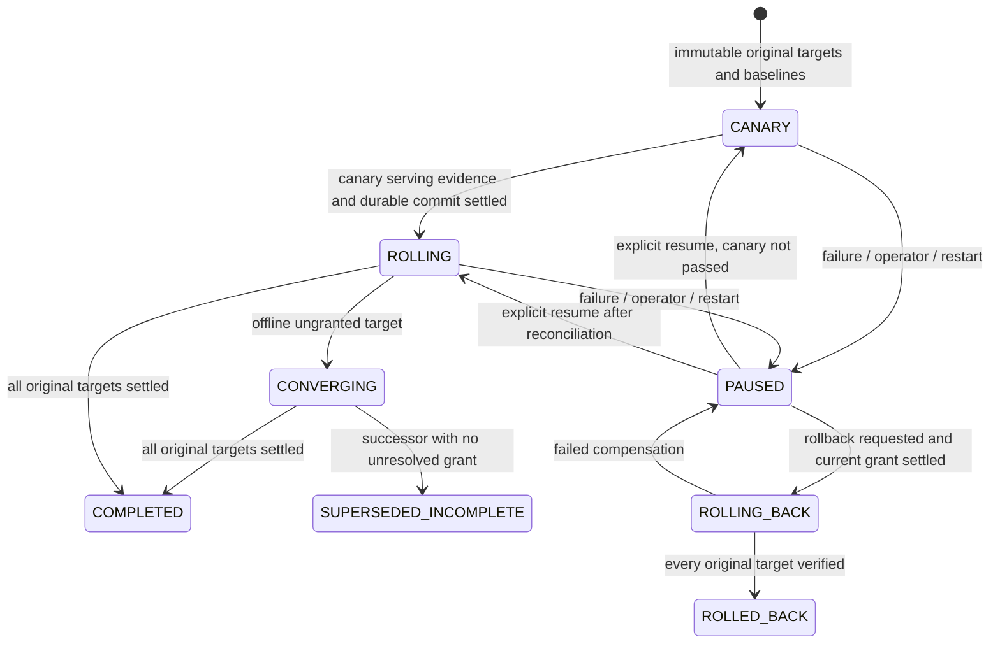

# MVP architecture and protocol

One Controller coordinates three manually enrolled Linux ARM64 nodes running one
trusted stateless Python HTTP app. There is one current fleet intent, one
designated canary and one unresolved grant at a time. No HA, copied controller
database, remote filesystem or data migration support is implied.

`fleetweft.mvp` is the authenticated service; `fleetweft.coordinator.Coordinator`
wraps the explored Controller protocol with fixed membership and durable fleet
state. `fleetweft.agent.Agent` pulls one command at a time and invokes the original
Node route writer. There is no public node mutation endpoint. Application traffic
uses the node's read-only `/work` gateway and pinned worker route.

The Controller uses a buffered snapshot while processing each request, then makes
one SQLite save. Core `finish/reconcile`, target result, canary decision and event
are committed together; a failure before that save leaves the prior grant occupied.
There are no independent stores whose success must be inferred from ordering.

Pause/cancel cannot revoke a committed decision by forgetting it. A commit already
authorized may still finish; rollback is a new higher-generation operation. A
not-yet-accepted cancelled grant is durably refused/fenced at the node before its
slot is cleared. An unreachable target cannot be assumed to have done either.

On startup, the node requires provisioned state and a verifiable committed cache.
It increments its persistent boot sequence, retires recorded old workers, and
reconstructs the committed route. An uncommitted operation becomes restored; a
committed one remains committed. Controller startup invalidates observations,
retains pending grants, and pauses nonterminal fleet work for reconciliation.
The Controller compares provisioned UUID, monotonic boot sequence and current
incarnation before accepting reports. Delayed commands still pass through the
Node mutation lock and exact accepted-token/incarnation checks at execution time.

Signed payloads are verified before cache promotion and again before startup.
A malformed or unauthenticated new artifact is durably refused; a failed candidate
startup compensates via the same Node cancel path. If compensation itself fails,
the Controller retains occupancy. New grants require one other fresh healthy
observation; this cannot prove that node remains available after the observation.

All three agents in the evidence share one VM. The fixed application, shared
service UID, single controller, finite histories/cache and manual trust catalog
are deliberate MVP constraints, not a production fleet security model.

## Durable operation contract

1. The Controller persists one grant and its occupied slot before delivering it.
   It contains Controller epoch, deployment generation, node, operation ID, target
   digest and baseline. Re-delivery returns the identical grant.
2. The agent accepts against its incarnation and committed baseline, persisting
   the grant/generation before activation. Duplicate acceptance changes nothing.
3. Activation checks the current accepted grant under the same mutation lock
   used to change the route. Cached preflight success is never authority to write.
4. Canary evidence binds operation, current agent incarnation and exact backend
   descriptor. A rotating challenge and sequence reject replay; Controller-local
   monotonic intervals bound sample age and observation duration. These clocks
   are not compared across machines.
5. Before local COMMITTED, the node requests a durable Controller commit decision.
   Missing, cancelled, paused, stale or insufficient observations cannot authorize
   a new decision. Loss of the decision response leaves an unresolved operation.
6. A local durable result is then reported. A lost terminal response can be retried
   identically. Occupancy is not released by heartbeat timeout or presumed failure.

The MVP binds node identity fields to manually enrolled mTLS certificate roles.
The old HTTP exploration entry point remains isolated test infrastructure only.

## Pause, cancellation and rollback

`PAUSED` stops new grants. It does not remotely invalidate an already issued
capability. `QUIESCED` means no unresolved grant remains. Increasing epoch after a
Controller restart does not revoke a remote grant without reconciliation.

Cancellation is a request. The Controller retains occupancy until the node reports
a confirmed terminal result. If a commit decision was already delivered, the node
may still commit after pause/cancel was requested; record that result, pause and
require an explicit next decision. Never pretend cancellation instantly stopped it.

A local compensation restores the baseline within the original operation and
reports `FAILED_RESTORED`; that is not candidate success. A later fleet rollback
uses a new, higher generation pointing to each node's captured baseline.
A target is not restored globally until that new operation has been verified.

## Recovery

Controller startup increments its durable epoch, retains unresolved occupancy and
invalidates in-memory-observation assumptions. Pending work needs reconciliation;
it cannot silently authorize the next node. Reconciliation may acknowledge an
already authorized, durably committed result, but leaves the Controller paused.

On node process restart, the systemd fixture retires the unit cgroup. The runtime
also checks recorded Linux process identities using boot ID/start ticks and pidfd
before retiring an observed old worker. The MVP reconstructs
the verified signed committed artifact with a new worker identity. Uncommitted STAGED,
ACTIVATING or OBSERVING operations compensate to that committed baseline.

The fixture kills the actual service MainPID. At the after-route boundary it
observes real candidate HTTP responses while the journal still says ACTIVATING,
then SIGKILLs without a graceful application rollback. At after-commit, committed
state is already durable and recovery must reconstruct the candidate instead.
Those original exploration receipts concern process crashes. The current MVP
also retains a separate orderly VM stop/start test with a pre-agent journal
observation; neither establishes sudden power-loss recovery.

## Worker lifecycle

The accepted candidate and current baseline may coexist during observation.
After commit or compensation, the runtime retires obsolete workers and removes
their process handles and journal entries. Cancellation may briefly spawn a
replacement baseline before retiring both earlier workers; a hard peak of two
workers is not claimed. A successfully returned terminal operation retains one
worker in the tested fixed backend.

Request borrowing and route switching share a Condition lock. After a switch,
no new request can borrow the retired route. Existing borrows may complete while
the mutation owner waits up to 2.5 seconds; stalled requests can then be interrupted.
Retirement errors propagate and must not be interpreted as confirmed cleanup.
The portable concurrency test holds a real Node.work transport call at an Event
until retirement enters its wait, then verifies kill happens only after release.
The VM additionally checks real process identities and real slow HTTP responses.
The HTTP timing observation alone does not prove overlap at every scheduling point.
