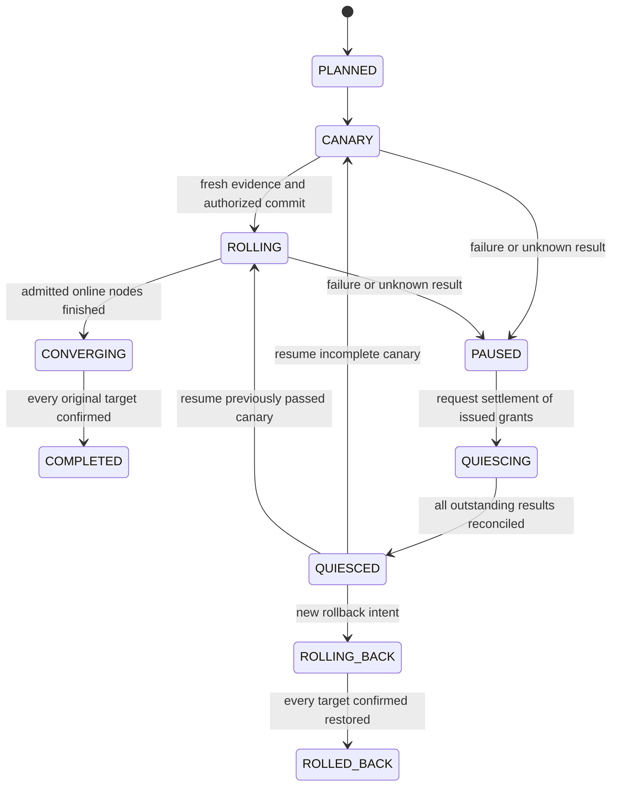

# Architecture and protocol after the four explorations

## Scope

The intended product coordinates a fixed set of three same-platform Linux nodes
running one stateless HTTP application. First release: one Controller, no HA,
one explicit canary, sequential changes and one active fleet intent. The current
code is the reusable exploration core and fixed application backend; the fleet
scheduler, artifact trust and authenticated enrollment are not implemented yet.

The Controller decides who may mutate. A node's unique route writer performs
each actual switch. Download/stage work must never receive direct gateway write
access. Services keep journals on local storage; network-backed state, copied
Controller databases and multiple Controller hosts are outside the first contract.

## Durable operation contract

1. The Controller persists one grant and its occupied slot before delivering it.
   It contains Controller epoch, deployment generation, node, operation ID, target
   digest and baseline. Re-delivery returns the identical grant.
2. The agent accepts against its incarnation and committed baseline, persisting
   the grant/generation before activation. Duplicate acceptance changes nothing.
3. Activation checks the current accepted grant under the same mutation lock
   used to change the route. Cached preflight success is never authority to write.
4. Canary evidence binds operation, current agent incarnation and exact backend
   descriptor. A rotating challenge and sequence reject replay; Controller-local
   monotonic intervals bound sample age and observation duration. These clocks
   are not compared across machines.
5. Before local COMMITTED, the node requests a durable Controller commit decision.
   Missing, cancelled, paused, stale or insufficient observations cannot authorize
   a new decision. Loss of the decision response leaves an unresolved operation.
6. A local durable result is then reported. A lost terminal response can be retried
   identically. Occupancy is not released by heartbeat timeout or presumed failure.

The exploration HTTP endpoints assume trusted test actors and isolated networking;
they are not an authenticated authorization scheme. Transport authentication and
enrollment must be added before a service can rely on the identity fields.

## Pause, cancellation and rollback

`PAUSED` stops new grants. It does not remotely invalidate an already issued
capability. `QUIESCED` means no unresolved grant remains. Increasing epoch after a
Controller restart does not revoke a remote grant without reconciliation.

Cancellation is a request. The Controller retains occupancy until the node reports
a confirmed terminal result. If a commit decision was already delivered, the node
may still commit after pause/cancel was requested; record that result, pause and
require an explicit next decision. Never pretend cancellation instantly stopped it.

A local compensation restores the baseline within the original operation and
reports `FAILED_RESTORED`; that is not candidate success. A later fleet rollback
will use a new, higher generation pointing to each node's captured baseline.
Fleet-wide rollback and rollback of a currently committed node are future work.

## Recovery

Controller startup increments its durable epoch, retains unresolved occupancy and
invalidates in-memory-observation assumptions. Pending work needs reconciliation;
it cannot silently authorize the next node. Reconciliation may acknowledge an
already authorized, durably committed result, but leaves the Controller paused.

On node process restart, the systemd fixture retires the unit cgroup. The runtime
also checks recorded Linux process identities using boot ID/start ticks and pidfd
before retiring an observed old worker. The current implementation reconstructs
the durable committed recipe with a new worker identity. Uncommitted STAGED,
ACTIVATING or OBSERVING operations compensate to that committed baseline.

The fixture kills the actual service MainPID. At the after-route boundary it
observes real candidate HTTP responses while the journal still says ACTIVATING,
then SIGKILLs without a graceful application rollback. At after-commit, committed
state is already durable and recovery must reconstruct the candidate instead.
These are process crashes in a running VM, not VM reboot or power-loss evidence.

## Later fleet state machine

UNKNOWN is a node observation, not success. A deferred node that has never
accepted a grant may eventually skip superseded compatible versions. A node with
an unresolved grant must first settle or fence it. Latest-version catch-up and
fleet target tracking are acceptance conditions, not current implementation claims.

`max_active_changes` and `min_observed_healthy` are separate policies. The latter
is an admission rule based on finite observations, not proof of remote availability.
Retiring an unreachable target must preserve the original incomplete outcome and
create a new target-set revision; it cannot turn the original rollout into success.

## Runtime and trust decisions still required

Shiftstead is not assumed to satisfy this backend contract: it retains a running
rollback process and may end the rollback window on restart. The fixed backend
demonstrates durable reconstruction of built-in releases; it does not prove that a
general artifact backend or Shiftstead adapter can reconstruct retained versions.

Use standard TLS/signature libraries and a fixed artifact-origin allowlist for the
MVP. Pin rollback artifacts separately from cache eviction. Stateless compatible
releases only; no database migrations, firmware, bootloader or arbitrary shell.
Keep pending/committed identity and actual HTTP observations separate in reports.
